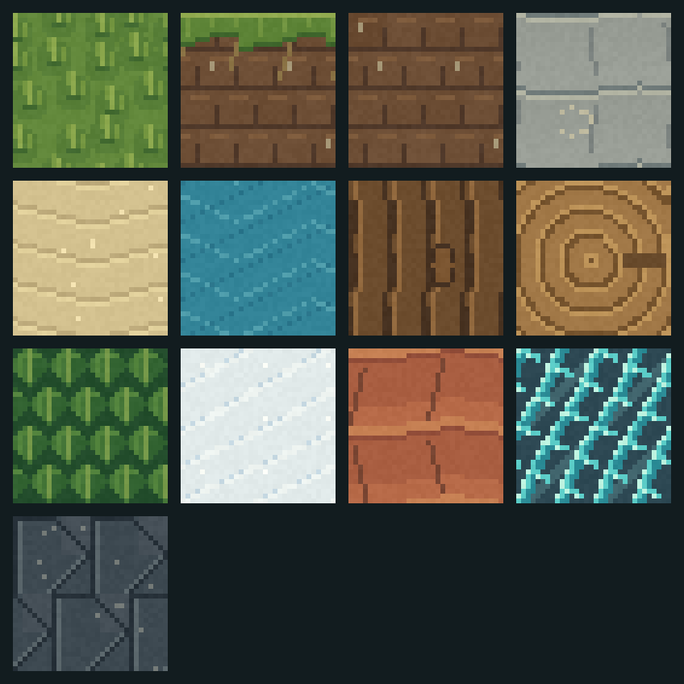

# STRATA — The Emerald Reach

An original Rust voxel engine and game in active development. **STRATA is a working title.** The full objective is a premium engine-led game spanning a living world, engineering/automation and exploration, eventually suitable for a credible Microsoft pitch. This initial build is not that finished product.

The authoritative local project is `C:\WPAI\Software\Rust Based Voxel`, an independent Git repository. Its verified `origin` is [MrWizard94-Compile/Strata](https://github.com/MrWizard94-Compile/Strata), a public repository. The director authorized committing and pushing source checkpoints; the development branch contains ongoing engineering work, not a production release.



## Build and play

Rust 1.97.1 with the MSVC toolchain is required on Windows. The repository pins its toolchain and primary libraries; `Cargo.lock` pins the resolved dependency graph. Cargo downloads required crates from crates.io. A compatible GPU and current graphics driver are needed.

```powershell
Set-Location 'C:\WPAI\Software\Rust Based Voxel'
cargo build --release --locked
.\target\release\strata.exe
```

Or run `./run.ps1` from PowerShell. The script builds when necessary, sets the working directory and records startup/runtime diagnostics under `logs/`. Saves live in `saves/emerald-reach`; retain both `world-a.json` and `world-b.json` when backing up. An OS lock rejects a second client opening the same world and releases on process exit; the empty `world.lock` marker can remain.

The client supports `--seed <u64>` for a new world and `--save-dir <path>` for a separate world. An existing world retains its stored seed. `--smoke-seconds <1..120>` launches the real native client and exits after the stated duration for graphics acceptance; this does not automate gameplay acceptance.

| Control | Action |
|---|---|
| Enter | Enter world / resume |
| WASD / mouse | Move / look |
| Space / Shift | Jump / sprint |
| F | Toggle creative flight |
| Space / Left Ctrl in flight | Rise / descend |
| Left click or X | Break targeted block |
| Right click or C | Place selected material |
| 1–8 / mouse wheel | Select material |
| Arrow keys | Turn camera without mouse |
| F5 | Save world |
| F3 | Toggle frame-time and world statistics |
| Escape | Pause / resume |

## Verification

```powershell
cargo fmt --check
cargo test --locked
cargo test --locked native_gpu_validates_all_world_shader_pipelines -- --ignored --nocapture
cargo clippy --locked --all-targets -- -D warnings
cargo build --release --locked
```

The GPU test is opt-in because it requires real hardware. Running it validates shader pipelines, not the window/input/save lifecycle. Native playtest evidence and remaining gates are recorded in [docs/STATUS.md](docs/STATUS.md).

Flight is collision-free for development exploration; move clear of solid terrain before toggling back to walking. New spawns and fall recovery test the entire body against trees and construction.

## Materials and CPU benchmarks

The renderer samples thirteen original **32×32** sRGB material tiles, including grass top/side/underside and timber endgrain. Tiles repeat per block across merged faces. Six mip levels filter distant surfaces. These are initial art assets, pending full in-world and director review.

`--export-materials <new-directory>` exports the exact runtime tiles as individual PNGs, a contact sheet and a manifest. The directory must not already exist and its parent must exist. Exported edits are not yet hot-reloaded into the game.

Run `./benchmark-cpu.ps1` for a release CPU meshing report plus source/binary hashes and hardware provenance. Use `-ReportPath` for an explicit new filename; `-SkipBuild` is only for a binary already verified against the current source. See [the measurement contract](docs/BENCHMARKING.md). The fixed six-scenario CPU workload does not measure game FPS or total memory.

## Project records

- [Stages, phases, micro-agent ownership and gates](docs/PROJECT-TRACKER.md)
- [Implemented architecture and known limits](docs/ARCHITECTURE.md)
- [Evidence and current checkpoint](docs/STATUS.md)
- [Original material design and provenance](docs/MATERIALS.md)
- [Primary research and experiment gates](docs/RESEARCH.md)
- [Game pillars and pitch acceptance criteria](docs/PRODUCT-BRIEF.md)

Source is private/unpublished project work. No general redistribution license has been selected. Third-party crates retain their own licenses; dependency license/advisory review is a separate release gate.

## Streaming diagnostics and CI

`./trace-streaming.ps1 -TracePath evidence/new-trace.jsonl -SmokeSeconds 30` builds and records a native run with exact source/binary/hardware provenance. It starts on the title scene. See [STREAMING.md](docs/STREAMING.md) for admission limits, reproducible stress fixtures, observed costs and measurement limits. The Windows source-check workflow runs formatting, tests, strict linting, a locked release build and launcher syntax checks; it does not establish native GPU or interactive acceptance.
